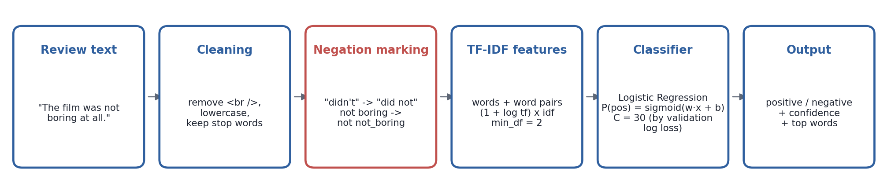
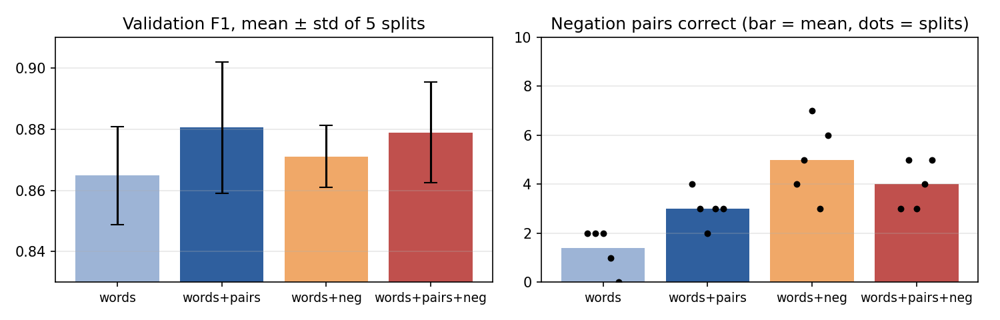
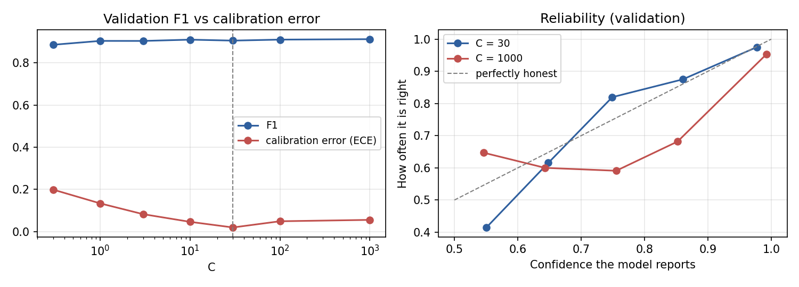
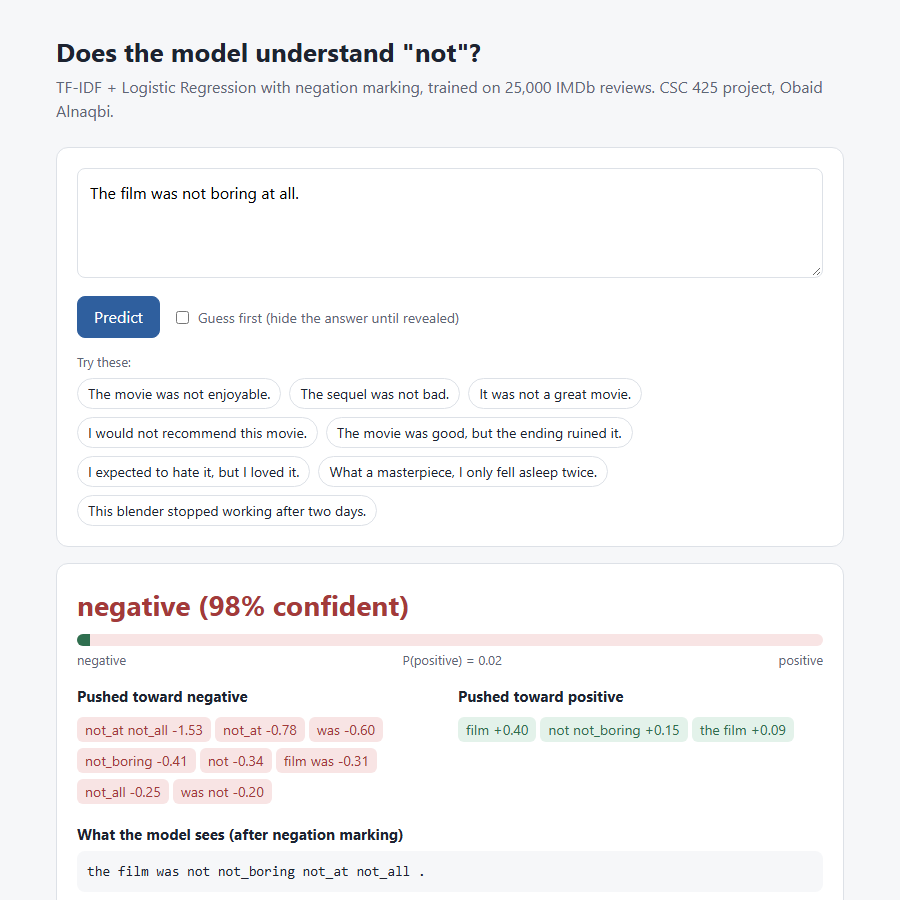

# Sentiment Analysis of Movie Reviews: Can a Model Understand "Not"?

CSC 425 AI Term Project (solo), Obaid Alnaqbi



## What will be done in this project?

It categorizes movie reviews as **positive** or **negative** and investigates one question: **can the model identify how the word "not" changes the meaning of a review?** "The film was boring." vs "The film was not boring."

The final system gets to **90.7% accuracy** on the IMDb test set of 25,000 reviews with well-calibrated confidence, and includes a small web demo which illustrates which words were responsible for each prediction. The most interesting result: the high accuracy is not accompanied by an understanding of negation. On IMDb, "not bad" is more likely to be used in negative reviews, so a model trained on the rating of the whole review learns that "not bad" indicates a negative review.

## How does the AI approach work?

1. **Cleaning:** remove `<br />` tags, lowercase. Stop words are not removed, as "no", "not" and "never" appear on many stop-word lists.
2. **Negation marking** (Das & Chen, 2001; Pang et al., 2002): expand contractions ("didn't" -> "did not"), then add `not_` to the words that follow a negation until a punctuation mark or "but": `not boring at all` -> `not not_boring not_at not_all`.
3. **TF-IDF features:** single words and pairs of neighbouring words, `(1 + log tf) x idf`, terms that appear in at least 2 reviews.
4. **Logistic Regression** with C = 30, selected by the lowest validation log loss so that the confidence scores are honest.

Baselines compared along the way: Multinomial Naive Bayes, words only vs words + pairs, with and without negation marking, different C/alpha, and different numbers of training reviews (3,200 to 25,000). For details please refer to the [final report](final/CSC%20425%20Final%20Project%20Report.pdf).

## What data/resources are needed?

All the data is downloaded automatically the first time a script is executed (around 45 MB, into `data/imdb/` and `data/extra/`, which are ignored by git):

| Data | Source | Used for |
|---|---|---|
| IMDb Large Movie Review Dataset (Maas et al., 2011): 25k training and 25k test reviews | [Stanford](https://ai.stanford.edu/~amaas/data/sentiment/), downloaded from the [Hugging Face mirror](https://huggingface.co/datasets/stanfordnlp/imdb) | training and validation (taken from the training split), final test |
| Rotten Tomatoes sentences (Pang & Lee, 2005), test split | [Hugging Face](https://huggingface.co/datasets/cornell-movie-review-data/rotten_tomatoes) | sentence-level transfer test |
| Amazon product reviews, English (Keung et al., 2020), test split | [Hugging Face](https://huggingface.co/datasets/mteb/amazon_reviews_multi) | domain transfer test |
| `data/challenge_negation.csv` | written by me, before any model was run on it | 10 sentence pairs about negation |
| `data/challenge_mixed_sarcasm.csv` | written by me, before any model was run on it | 10 mixed-opinion + 10 sarcastic sentences |

Just a normal laptop CPU is sufficient; no GPU is required.

## Where and how can I install/run it?

To install the requirements, run:

```bash
pip install -r requirements.txt
```

```bash
# Web demo (opens http://127.0.0.1:8000; trains the final model first if needed, ~1 min)
python src/demo_app.py

# Command-line demo
python src/predict.py "The movie was not enjoyable."

# Repeat all numbers and figures (results/ will be regenerated)
python src/run_milestone2.py     # baselines                                (~10 s)
python src/run_milestone3.py     # tuning, negation, learning curve, test   (~4 min)
python src/run_milestone4.py     # calibration, final system, transfer      (~3 min)
```

The work for Milestones 2 and 3 is shown step by step, with outputs, in the notebooks in `notebooks/`.

**Trained model:** `models/final_model.joblib` (Logistic Regression, words + pairs + negation marking, C = 30, trained on all 25,000 IMDb training reviews). It is not committed because it is too big; `run_milestone4.py` or `demo_app.py` recreates it.

## What are the main results?

**IMDb test set (25,000 reviews):**

| Model | Training reviews | Accuracy | F1 | Calibration error (ECE) |
|---|---|---|---|---|
| M2 baseline (words + pairs, C = 1) | 3,200 | 0.856 | 0.857 | 0.214 |
| M3 model (words + pairs, C = 1000) | 25,000 | 0.905 | 0.905 | 0.048 |
| **Final system (words + pairs + negation, C = 30)** | 25,000 | **0.907** | **0.907** | **0.010** |

**Other data (trained on IMDb only):** Amazon product reviews 80.1%, single sentences from Rotten Tomatoes 77.4%.

**Negation challenge (10 pairs, both sentences correct):** 3/10 (M2 baseline) -> 4/10 (final). Across five random splits, negation marking raised the single-word model from 1.4 to 5.0 pairs on average (+3.6) and improved it on every split, without hurting accuracy. More training data improved accuracy (F1 0.883 -> 0.916), while the negation score stayed the same.

**Why negation remains difficult:** among IMDb training reviews that contain "not bad", "not great" and "not good", the share that are positive is 33%, 52% and 24%, respectively. The labels describe whole reviews, not the meaning of the phrase in its sentence, so the model learns which phrases go with a rating rather than what they mean.

|  |
|---|
|  |
|  |

## Repository structure

```
ai course 425/
├── data/                      challenge sets (committed); downloads go to data/imdb, data/extra (ignored)
├── src/
│   ├── data_prep.py           download, balanced subset, cleaning, splits, extra datasets
│   ├── negation.py            contraction expansion + not_ marking
│   ├── baseline.py            TF-IDF pipelines, metrics
│   ├── run_milestone2.py      baselines
│   ├── run_milestone3.py      tuning, negation, stability, learning curve, test
│   ├── run_milestone4.py      calibration, final system, transfer
│   ├── predict.py             command-line demo
│   ├── demo_app.py            web demo server
│   └── demo_page.html         web demo page
├── notebooks/                 milestone2_baseline.ipynb, milestone3_experiments.ipynb
├── results/                   tables (csv) and figures for each milestone
├── milestone 1/ ... milestone 3/   milestone reports (docx + pdf)
├── final/                     final report (docx + pdf)
└── requirements.txt
```

## Progress notes

- **Milestone 1:** the proposal is done, IMDb is selected and the repo is created.
- **Milestone 2:** following feedback, kept stop words and added the negation question; wrote the challenge pairs first; TF-IDF + LogReg/Naive Bayes baselines, words vs words + pairs; 88% validation accuracy, 3/10 negation pairs.
- **Milestone 3:** tuning, negation marking, a 5-split stability check, negation scope, the learning curve and a one-time test evaluation (90.5%). Found that the review-level labels explain most of the cases where the model gets negation wrong.
- **Milestone 4:** calibrated final system (90.7%, ECE 0.010), transfer to Rotten Tomatoes and Amazon, web demo, final report and presentation.

## Who contributed?

Solo project: **Obaid Alnaqbi** did the topic choice, challenge sentences, data preparation, modelling, experiments, analysis, demo, reports and presentation.

## External code, models and datasets

- **Libraries:** scikit-learn, pandas, NumPy, PyArrow, matplotlib, joblib, Jupyter.
- **Datasets:** IMDb (Maas et al., 2011), Rotten Tomatoes (Pang & Lee, 2005), Multilingual Amazon Reviews Corpus (Keung et al., 2020), all via Hugging Face.
- **Methods:** negation marking from Das & Chen (2001) and Pang et al. (2002); expected calibration error as in Guo et al. (2017).
- **Pretrained models:** none.

## References

1. Das, S., & Chen, M. (2001). Yahoo! for Amazon: Extracting market sentiment from stock message boards. APFA.
2. Guo, C., Pleiss, G., Sun, Y., & Weinberger, K. Q. (2017). On calibration of modern neural networks. ICML.
3. Keung, P., Lu, Y., Szarvas, G., & Smith, N. A. (2020). The Multilingual Amazon Reviews Corpus. EMNLP.
4. Maas, A. L., et al. (2011). Learning word vectors for sentiment analysis. ACL.
5. Pang, B., & Lee, L. (2005). Seeing stars: Exploiting class relationships for sentiment categorization with respect to rating scales. ACL.
6. Pang, B., Lee, L., & Vaithyanathan, S. (2002). Thumbs up? Sentiment classification using machine learning techniques. EMNLP.
7. Pedregosa, F., et al. (2011). Scikit-learn: Machine learning in Python. JMLR 12.
